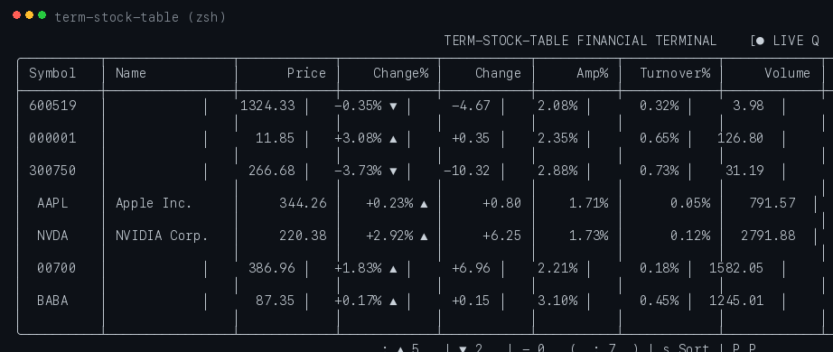
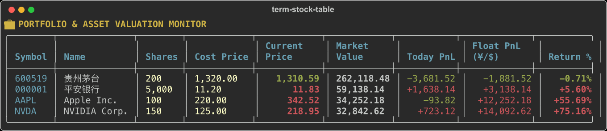
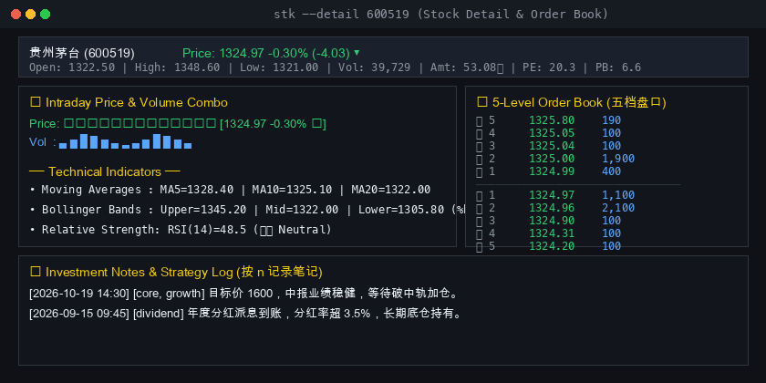
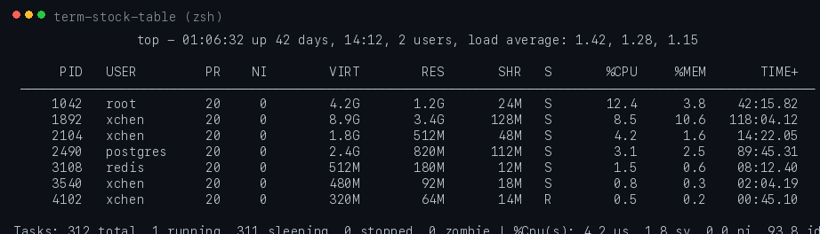

# term-stock-table 📊

> Professional terminal financial workstation: real-time stock watchlist, portfolio & PnL valuation, Bollinger Bands / MACD / KDJ quant indicators, candlestick charts, 5-level order book depth, capital flow analysis, smart price alerts, persistent trade notes, and instant stealth Boss Mode.

Built on top of [`term-sparkline`](https://github.com/brwchen/term-sparkline) for high-density inline vector sparklines and tick badges.

<p align="center">
  
</p>

---

## ✨ Features

- **Professional Financial Columns & Real-time Feeds**:
  - Live quote integration via high-speed API (A-Shares, HK, US stocks) with seamless offline simulation fallback.
  - Multi-market unified tickers: `600519` (Moutai), `000001` (Ping An), `300750` (CATL), `00700` (Tencent), `AAPL`, `NVDA`.
  - Comprehensive metrics: `Price`, `Change%`, `Change`, `Amplitude%`, `Turnover%`, `Volume`, `Turnover Amount`, `P/E`, `P/B`.
- **Portfolio & Asset Valuation Tracker (持仓与盈亏看板)**:
  - Track stock positions, cost basis, and shares directly from terminal (`stk --position 600519 100 1350.0`).
  - Real-time floating PnL (¥/$), percentage returns, and today's PnL asset summary.
  - Press <kbd>P</kbd> in TUI mode to toggle between Watchlist and Portfolio Holding views.
- **Bollinger Bands & Quant Indicators**:
  - Compact Bollinger Bands %b position badge: `[··●··]` (Mid), `[····▶]` (Overbought), `[◀····]` (Oversold).
  - Built-in Moving Averages (MA5, MA10, MA20), RSI(14), MACD (12,26,9), and KDJ (9,3,3) oscillators.
  - Valuation percentile meter (PE/PB historical valuation ranking).
- **Stock Detail View, Candlesticks & 5-Level Order Book (五档盘口)**:
  - Deep-dive view with intraday tick curves, multi-period ASCII/Unicode candlestick charts (press <kbd>k</kbd> to toggle).
  - Real-time Bid/Ask five-tier order depth and Capital Flow (主力/超大单/散户净流入) breakdown.
- **Smart Price & Volatility Alerts (智能价格预警与通知)**:
  - Configure target high, stop low, and volatility threshold alerts (`stk --alert 600519 high=1800 low=1200 pct=3.0`).
  - Automatic non-blocking macOS Notification Center alerts and visual table badges (`🚨`).
- **Persistent Investment Journal & Strategy Notes**:
  - Record target prices, stop-loss levels, and trade rationales directly from terminal (stored locally in `~/.term_stock/notes.json`).
- **Market Sentiment & Live Anomaly Radar (全市场情绪与异动雷达)**:
  - Market breadth meter (Up/Down ratio, Limit-up/Limit-down count, 2-market turnover and volume comparison).
  - Northbound / Southbound (沪深港通) net flow and intraday curve.
  - Live anomaly scanner (`🚀 火箭发射`, `💰 大单买入`, `⚡ 封涨停`, `⚠️ 炸板`).
- **Sector Heatmap & Industry Ranking (行业与概念板块热力图)**:
  - Unicode block heatmap matrix with dynamic heat intensity and net inflow rankings (`stk --sector`).
- **Intraday Chart & Chip Volume Distribution (分时走势与筹码分布)**:
  - High-definition intraday price curve with VWAP average line and time axis (`stk --intraday 600519`).
  - Cost volume profile histogram with profit ratio (%) and 90% concentration range (`stk --chips 600519`).
  - Real-time tick tape trade order flow with active Buy/Sell markers (`stk --tape 600519`).
- **DuPont Analysis & Strategy Backtesting (杜邦财报与量化回测)**:
  - DuPont identity breakdown (ROE, Net Profit Margin, Asset Turnover, Financial Leverage) (`stk --dupont 600519`).
  - Fast/Slow SMA crossover and trend backtester with terminal equity curve comparison (`stk --backtest 300750`).
- **Multi-channel Webhooks & Data Importer (多端机器人预警与数据导入)**:
  - Multi-endpoint alerts: Feishu / DingTalk / WeCom / Slack / Telegram / Webhook (`stk --webhook-test`).
  - Two-way CSV portfolio position import/export (`stk --import-csv` / `stk --export-csv`).
- **Tmux & WezTerm Statusline Component (极客状态栏小组件)**:
  - Single-line compact ticker string for terminal status bars (`stk --statusline`).
- **Theme Ecosystem & Custom Visual Palettes (主题生态与个性化配色)**:
  - 8 curated visual themes: **Bloomberg Terminal Classic**, **Tokyo Night**, **Catppuccin Mocha**, **Cyberpunk Neon**, **Nord Frost**, **Gruvbox Retro**, plus **Classic CN** (Red ▲) and **Classic US** (Green ▲).
  - Press <kbd>T</kbd> in TUI to switch themes dynamically with instant persistent storage or run `stk --theme tokyo-night`.
- **Custom Indicator Formula Scripting Engine (AST 自定义指标公式系统)**:
  - Safe sandboxed Python AST parser supporting math expressions, moving averages, standard deviation, and custom quant oscillators (`MA`, `EMA`, `STD`, `TYPICAL_PRICE`, `DEV_MA20_PCT`, `INTRADAY_AMPLITUDE`).
  - Press <kbd>F</kbd> in TUI to evaluate or test custom formula expressions, or run `stk --formula TYPICAL_PRICE --symbols 600519`.
- **Geek Multi-Pane Tmux Trading Floor Layout (Tmux 多窗格极客工作站)**:
  - Generate or launch a 4-pane tmux trading station with synchronized Watchlist, Sector Heatmap, Anomaly Radar, and Real-time Tape (`stk tmux-launch` / `stk --tmux-layout`).
- **Kitty & iTerm2 Inline Pixel Graphics Protocol (终端矢量/像素原图渲染)**:
  - Native inline PNG candlestick chart rendering using Kitty graphics protocol (`_Ga=T`) and iTerm2 inline image protocol (`]1337;File=inline=1`) (`stk --pixel-chart 600519`).
- **Full Vim Ergonomics (极客 Vim 快捷键导航)**:
  - Seamless Vim navigation: <kbd>j</kbd>/<kbd>k</kbd> step rows, <kbd>g</kbd> jump to top, <kbd>G</kbd> jump to bottom, <kbd>/</kbd> quick search.
- **Stealth Boss Mode (摸鱼神器 / Boss Key)**:
  - Press <kbd>b</kbd> or <kbd>ESC</kbd> to instantly camouflage into real-time system monitoring or developer logs:
    - **DevOps Profile**: Linux `top` / `htop` dynamic process table.
    - **Kubernetes Profile**: `kubectl get pods -A` cluster status.
    - **Neovim Profile**: Asynchronous Rust/Python distributed system buffer.
    - **GDB Profile**: Interactive debugger breakpoint session.
    - **C++ Build Profile**: CMake / Ninja compilation stream (`[ 82%] Building CXX object...`).
    - **Git Diff Profile**: Code review and diff viewer.
    - **PyTorch ML Profile**: Deep learning training epoch loss loop.
    - **Nginx Profile**: `tail -f /var/log/nginx/access.log` HTTP stream.
    - **Monochrome Profile**: Grayscale neutral sensor telemetry table without market colors.
- **Multi-period charts**: click a stock's code/name (or press Enter), then click (or press `1`-`8`) to switch between intraday / 5-60min / daily / weekly / monthly K-lines (real Tencent data for A-shares, HK and US daily+; simulated fallback otherwise).
- **Bilingual UI**: press `L` in the TUI to switch between English and 中文 (saved to settings), or start with `stk --lang zh`.
- **Interactive TUI** (`stk`): Full-featured Textual terminal dashboard with keyboard shortcuts, sorting and smooth image curves on iTerm2.

---

## 📦 Installation

```bash
pip install term-stock-table
```

*(Includes `term-sparkline`, `rich`, and `textual` out of the box).*

---

## 🚀 Quick Start

### 1. Launch Interactive Financial Terminal (TUI)

```bash
# Launch default watchlist dashboard
stk

# Or track specific symbols
stk --symbols 600519,000001,300750,AAPL,NVDA,00700
```

### 2. Portfolio Asset Valuation Mode

```bash
# Set position: 100 shares of 600519 at cost price ¥1350.0
stk --position 600519 100 1350.0

# View real-time portfolio holdings & PnL
stk --portfolio
```

### 3. Smart Price Alerts & Desktop Notifications

```bash
# Configure alert for price targets or 3% volatility
stk --alert 600519 high=1800 low=1200 pct=3.0

# List active alerts
stk --alerts
```

### 4. Indices & Reports

```bash
# Display global major indices banner
stk --indices

# Export comprehensive daily review report
stk --export-daily daily_review.md
```

### 5. Quick Detail View & Investment Notes

```bash
# Open single stock detail view
stk --detail 600519

# Add an investment note from CLI
stk --note 600519 "Target price 1800, stop loss 1250, wait for Q3 earnings"

# View all saved investment notes
stk --notes
```

### 6. Direct Boss Mode Launch

```bash
# Start directly in stealth camouflage mode
stk --boss --boss-profile cpp
```

---

## ⌨️ Interactive TUI Keybindings

| Key | Action | Description |
|:---:|:---|:---|
| <kbd>j</kbd> / <kbd>k</kbd> / <kbd>↓</kbd> / <kbd>↑</kbd> | **Navigate** | Move cursor down/up in table (Vim navigation) |
| <kbd>g</kbd> / <kbd>G</kbd> | **Home / End** | Jump to top / bottom of watchlist |
| <kbd>T</kbd> | **Theme Selector** | Open theme picker (Bloomberg, Tokyo Night, Catppuccin, Cyberpunk, Nord, Gruvbox) |
| <kbd>F</kbd> | **Custom Formula** | Open safe AST indicator formula expression calculator |
| <kbd>b</kbd> / <kbd>ESC</kbd> | **Boss Key (摸鱼模式)** | Toggles the disguise. The default `ops` profile shows a `top` process list with holdings mixed in as rows named by the stock-name initials (e.g. `GZMT`) (RES = price, %CPU = change, VIRT = position, HIST = line trend) and the detail page as latency charts; <kbd>Tab</kbd> cycles other profiles. Auto-engages after `stealth_idle` seconds (default 20, `0` disables) idle or on terminal blur; any key restores |
| <kbd>Ctrl</kbd>+<kbd>B</kbd> | **Boss Key in input dialogs** | Same as <kbd>b</kbd> where typing is active |
| <kbd>Tab</kbd> | **Next Boss Profile** | Cycles camouflage disguise (DevOps → K8s → Neovim → GDB → C++ → Git → PyTorch → Nginx → Mono) |
| <kbd>Enter</kbd> | **Stock Detail View** | Opens deep detail page (OHLC, Indicators, 5-Level Depth, Capital Flow, Notes) |
| <kbd>k</kbd> | **Toggle K-Line** | In detail view, toggle between Multi-period Candlestick & Sparklines |
| <kbd>R</kbd> | **Market Radar** | Opens Market Breadth sentiment, Northbound flow & live anomaly scanner |
| <kbd>S</kbd> | **Sector Heatmap** | Opens Industry & Concept heatmap matrix and inflow rankings |
| <kbd>B</kbd> | **Strategy Backtest** | Runs quantitative SMA strategy backtest with equity curve |
| <kbd>P</kbd> | **Portfolio View** | Toggle between Watchlist Mode and Portfolio Asset Holdings Mode |
| <kbd>s</kbd> | **Sort Column** | Cycle sort column (`change_pct`, `price`, `volume`, `amount`, `pe`) |
| <kbd>r</kbd> | **Reverse Order** | Toggle between Descending (▼) and Ascending (▲) sorting |
| <kbd>l</kbd> | **Set Price Alert** | Opens dialog to configure price targets and volatility alerts |
| <kbd>n</kbd> | **Add Note** | Opens note editor modal for the highlighted stock |
| <kbd>a</kbd> / <kbd>/</kbd> | **Add Stock** | Search and add stock symbol to persistent watchlist |
| <kbd>d</kbd> | **Delete Stock** | Remove highlighted stock from watchlist |
| <kbd>p</kbd> | **Toggle Palette** | Switch between CN (Red ▲) and US (Green ▲) palettes |
| <kbd>q</kbd> | **Quit** | Exit application |

---

## 🎨 Visual Showcase & Feature Matrix

### 1. Watchlist Overview & Live Streaming
> High-density real-time financial monitoring with automatic CN/US market color schemes, volume formatting, and inline Sparklines.
<p align="center">
  
</p>

---

### 2. Portfolio Holdings & Real-Time PnL Valuation
> Real-time position tracking, cost basis accounting, floating profit/loss (¥/$), return rates, and today's PnL asset summary.
<p align="center">
  
</p>

---

### 3. Bollinger Bands & Quant Indicators Matrix
> Intuitive `%b` position badges mapping whether prices are riding the upper band, oscillating in the middle, or oversold below the lower band.
<p align="center">
  
</p>

---

### 4. Market Sentiment & Anomaly Radar
> Real-time market breadth score, Up/Down ratio, Northbound/Southbound capital flow sparklines, and rocket surge / dump anomaly log.
<p align="center">
  
</p>

---

### 5. Sector & Concept Heatmap Matrix
> Graphical matrix heatmap of industry sectors with dynamic color heat intensities, net capital inflows, and top leading stocks.
<p align="center">
  
</p>

---

### 6. Intraday VWAP, Volume Profile & Tick Tape
> Intraday dual-line price vs VWAP chart, multi-peak cost volume chip distribution, and active Buy/Sell tick order tape.
<p align="center">
  
</p>

---

### 7. Stock Detail View, Candlesticks & 5-Level Order Book
> Multi-panel stock analysis workstation with intraday Price+Volume combo curves, ASCII Candlesticks, MA/MACD/KDJ/RSI indicators, Capital Flow, and Bid/Ask depth.
<p align="center">
  
</p>

---

### 5. Stealth Boss Mode (One-Key Camouflage)
> Millisecond-level one-key disguise into Linux `top`, `kubectl get pods`, C++ compilation (`ninja`), Git diffs, PyTorch training loops, or `nginx` logs.
<p align="center">
  
</p>

---

## 🗺️ Architecture & Component Map

| Module / Component | File | Description |
|:---|:---|:---|
| `api.py` | Core Data | Real-time quote fetcher (Tencent API) & offline Geometric Random Walk simulator |
| `portfolio.py` | Asset Engine | Position cost accounting, floating PnL, today PnL, and asset valuation tables |
| `alerts.py` | Smart Alerts | Price target detection, threshold evaluation, and macOS desktop notifications |
| `indicators.py` | Quant Analytics | Bollinger Bands, SMA, RSI, MACD, KDJ, Candlesticks, and valuation percentiles |
| `market.py` | Macro & Flow | Major indices banner and multi-tier capital flow simulation |
| `radar.py` | Radar & Sentiment | Market breadth sentiment meter, Northbound connect flow & live anomaly scanner |
| `tick.py` | Intraday & Chips | Intraday chart with VWAP line, chip cost volume profile & tick tape |
| `sector.py` | Sector Heatmap | Industry sector matrix heatmap and leading stock breakdown |
| `fundamentals.py` | Financials | DuPont identity breakdown, health ratios & Dragon-Tiger seat dynamics |
| `backtest.py` | Quant Backtest | Moving Average & MACD strategy backtester with terminal equity curves |
| `webhook.py` | Integrations | Multi-channel Webhook alert dispatcher (Feishu/DingTalk/WeCom/Slack/TG) |
| `importer.py` | Data Pipeline | Two-way CSV portfolio position import and export |
| `statusline.py` | Geek Tools | Ultra-compact single-line status ticker for Tmux and WezTerm |
| `config.py` | Storage | Persistent Watchlist, Portfolio, Alerts, Notes, and Settings in `~/.term_stock/` |
| `table.py` | UI Engine | Professional Rich Table generator with customizable columns, sorting & sparklines |
| `detail.py` | Detail View | Multi-panel stock detail layout (Combo chart, 5-level order book, Capital flow, Notes) |
| `boss.py` | Privacy | Boss mode camouflage engines (`devops`, `kubectl`, `cpp`, `git`, `python`, `nginx`) |
| `tui.py` | Interactive | Textual reactive application with modals, timers, sorting, and keybindings |
| `cli.py` | CLI Interface | Dual-mode CLI entrypoint (`stk` / `stock-table`) |

---

## 📄 License

MIT © [brwchen](https://github.com/brwchen)


